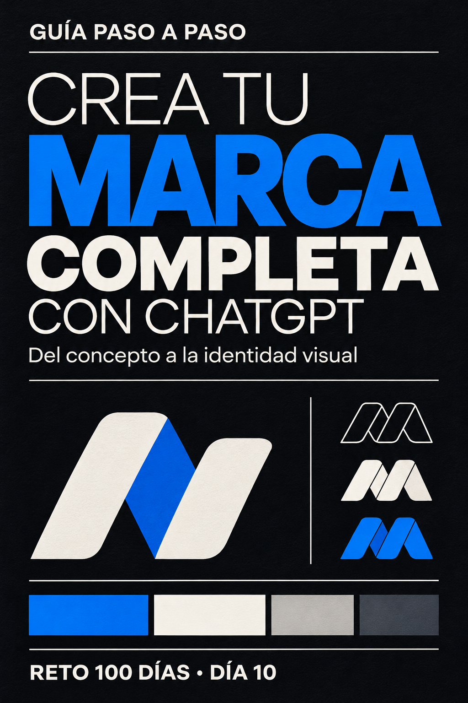

# Crea tu marca completa con ChatGPT

## Descargas

- **[Ebook completo: 50 páginas](https://raw.githubusercontent.com/Samuelacuna12/freebies/main/crea-tu-marca-con-chatgpt/guia.pdf)**
- [36 prompts copiables](prompts.txt)
- [Ocho plantillas de trabajo](plantillas.md)
- [Guía completa en texto](guia.md)
- [Portada](portada.png)

## Qué harás

1. Ordenar la evidencia de tu cliente, la oferta y el brief.
2. Investigar Pinterest y Behance y seleccionar cinco referencias sin copiarlas.
3. Dar contexto a ChatGPT y explorar tres rutas visuales.
4. Elegir con una rúbrica e iterar una variable por vez.
5. Preparar tipografía, color, variantes y archivos utilizables.
6. Probar aplicaciones, documentar el sistema y cerrar la entrega.

El PDF incluye índice clicable, marcadores, enlaces a las fuentes y **33 controles de formulario**: 25 campos de texto y ocho casillas. Descárgalo, rellénalo en un lector compatible y guarda una copia propia. Las plantillas Markdown ofrecen una alternativa para cualquier editor de texto.

Los ejemplos utilizan **LUMA CASA**, un caso ficticio. Sustituye su nombre y sus datos por los de tu proyecto. Su disponibilidad no ha sido verificada y no representa resultados de un negocio real.

Versión 1.0 · 25 de noviembre de 2026.
